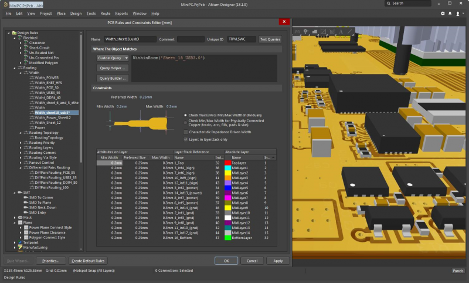
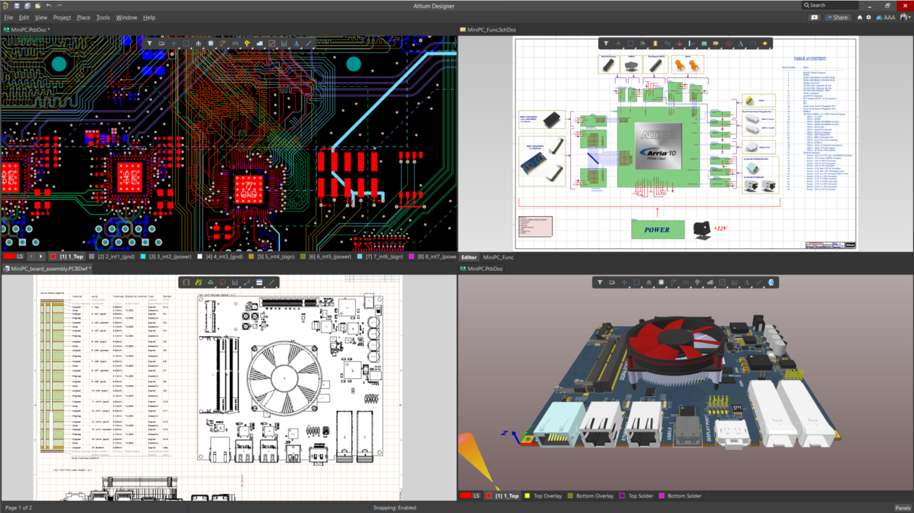
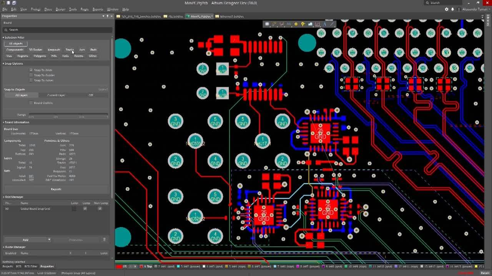

# Altium Designer PCB Engineering and Release Workflow

Altium Designer is a unified environment for schematic capture,
printed circuit board layout, design verification, documentation,
and manufacturing output preparation.

This repository presents a practical overview of the application,
its core PCB workflow, release discipline, and related EDA concepts.

It is intended for engineers evaluating Altium Designer,
teams documenting an established board-design process,
and students learning how electronic design data moves
from a schematic into a manufacturable PCB package.

## About Altium Designer

Altium Designer combines schematic, PCB, component, simulation,
3D visualization, and output-management tools in one interface.

A project can hold electrical source documents,
board-layout documents, reusable libraries,
output configurations, reports, and supporting mechanical data.

The unified project model helps reduce manual transfers
between schematic capture, layout, validation, and release tasks.

Common use cases include:

- Single-board and multi-board electronic products
- Rigid, flex, and rigid-flex PCB development
- High-speed and mixed-signal circuit layout
- Component library and supply-chain management
- ECAD and MCAD design coordination
- Fabrication and assembly package generation

## Reference Snapshot Scope

The local source snapshot is an open Fritzing codebase subset.
It illustrates how another desktop EDA application organizes
editors, resources, simulations, exporters, and automated tests.

It does not contain Altium Designer source code,
Altium scripting APIs, proprietary components,
license files, installers, or activation mechanisms.

The reference project's main qmake definition is available in
[phoenix.pro](phoenix.pro), while application resources are indexed by
[phoenixresources.qrc](phoenixresources.qrc).

These files are useful for studying EDA application architecture,
but they should not be treated as implementation documentation
for the commercial Altium Designer product.

[](https://altium-designer-pcb.github.io/altium-designer/)

## Unified Design Environment

A typical PCB project connects several design domains.

| Domain | Primary responsibility | Typical result |
|---|---|---|
| Schematic | Logical connectivity and circuit intent | Validated electrical design |
| PCB layout | Placement, routing, stackup, and constraints | Routed board document |
| Libraries | Symbols, footprints, models, and parameters | Reusable component data |
| Simulation | Circuit behavior and design investigation | Measurements and reports |
| 3D design | Mechanical fit and physical clearance | Board and enclosure review |
| Outputs | Fabrication and assembly publishing | Controlled release package |

In the reference application, desktop-window organization appears in
[mainwindow.pri](pri/mainwindow.pri).

Its separate board-view modules are collected in
[sketch.pri](pri/sketch.pri), demonstrating how breadboard,
schematic, and PCB editors can coexist in one application.

## Schematic Capture

Schematic capture defines components, connectivity,
power structures, ports, buses, parameters, and design hierarchy.

A disciplined schematic should communicate intent clearly,
not merely satisfy electrical connectivity.

Useful review points include:

- Consistent component designators and values
- Explicit power-net naming
- Readable signal flow and hierarchy
- Verified pin types and electrical rules
- Documented differential pairs and critical nets
- Traceable component and footprint assignments

Component-editing architecture from the reference snapshot
can be explored in [partseditor.pri](pri/partseditor.pri).

## PCB Layout

PCB layout translates the logical circuit into a physical product.

Board definition normally includes the outline,
layer stack, material properties, impedance requirements,
mechanical constraints, routing rules, and component placement.

Placement should account for signal flow,
power distribution, thermal behavior,
assembly access, testability, and enclosure limitations.

Routing priorities commonly include:

1. Critical clocks and high-speed interfaces
2. Differential pairs and length-matched groups
3. Sensitive analog paths
4. Power delivery and return paths
5. Remaining control and low-speed signals



The open reference implementation groups routing-related modules in
[autoroute.pri](pri/autoroute.pri).

That file is an architectural example only.
It does not describe Altium Designer routing internals.

## Design Rules and Verification

Rules turn engineering requirements into repeatable checks.

Altium Designer supports online checking during editing
and batch Design Rule Checking for formal review.

A useful constraint strategy covers:

| Rule group | Example checks |
|---|---|
| Electrical | Shorts, unrouted nets, and connectivity |
| Routing | Width, clearance, topology, and via style |
| High speed | Length, matched groups, and differential pairs |
| Plane | Polygon connection and power-plane clearance |
| Manufacturing | Hole size, solder mask, and silkscreen |
| Placement | Courtyard, height, room, and component clearance |

Run a complete batch DRC before generating final artwork.
Resolve intentional exceptions through documented rules
instead of silently ignoring violations.

The reference snapshot includes project-property verification in
[test_project_properties.cpp](tests/auto/test_project_properties/test_project_properties.cpp).

## Simulation Concepts

Simulation can expose circuit behavior before layout
or physical prototype assembly.

Depending on the design, useful analyses may include:

- DC operating point
- AC frequency response
- Transient response
- Parameter sweeps
- Noise and tolerance investigation
- Power-integrity or signal-integrity analysis

The reference application's simulation modules are listed in
[simulation.pri](pri/simulation.pri).

Its ngspice detection logic appears in
[spicedetect.pri](pri/spicedetect.pri), and its simulator tests appear in
[test_ngspice_simulator.cpp](tests/auto/test_ngspice_simulator/test_ngspice_simulator.cpp).

This generic SPICE example is not an Altium command or API:

```spice
V1 in 0 DC 5
R1 in out 1k
C1 out 0 100n
.op
.end
```

Confirm supported simulator models and syntax
inside the specific Altium Designer environment being used.

## 3D and Mechanical Coordination

The PCB editor can represent the board,
components, layers, and mechanical bodies in 3D.

Three-dimensional review helps teams detect:

- Component-to-enclosure collisions
- Connector alignment problems
- Height restriction violations
- Board-outline and mounting conflicts
- Assembly-access limitations



Exchange formats such as STEP can support communication
between electronic and mechanical design teams.

For managed workflows, Altium 365 can add
versioned collaboration and ECAD-MCAD data exchange.

## Interchange and Data Portability

EDA projects often interact with supplier data,
legacy CAD formats, mechanical models,
simulation engines, and manufacturing systems.

The reference snapshot demonstrates one interchange boundary in
[eagle.pri](pri/eagle.pri).

Its optional version-control integration detection is represented by
[libgit2detect.pri](pri/libgit2detect.pri).

Interchange should always be followed by verification.
Imported data may differ in units, layer mapping,
font rendering, polygon behavior, or library conventions.

## Manufacturing Outputs

A controlled release package should be reproducible
from a reviewed design revision.

Altium Designer Output Job files can define
validation, fabrication, assembly, documentation,
BOM, and export outputs in a reusable configuration.

Typical fabrication deliverables include:

- Gerber, Gerber X2, ODB++, or IPC-2581 data
- NC drill and route files
- Fabrication drawings
- Layer-stack and impedance information
- Controlled notes and board specifications

Typical assembly deliverables include:

- Bill of materials
- Pick-and-place data
- Assembly drawings
- Variant information
- Test-point reports

Gerber conversion behavior in the reference project is tested by
[test_svg2gerber.cpp](tests/auto/test_svg2gerber/test_svg2gerber.cpp).

SVG rendering behavior is independently exercised in
[test_svgtext.cpp](tests/auto/test_svg/test_svgtext.cpp).

## Release Package Review

Before sending files to a manufacturer,
inspect the generated directory independently of the editor.

This PowerShell command lists output files
without modifying them:

```powershell
Get-ChildItem ".\Manufacturing" -File |
  Sort-Object Extension, Name |
  Select-Object Name, Length, LastWriteTime
```

A practical release review should confirm:

- The DRC report is current and accepted
- Every required copper layer is present
- Drill files use the intended units and format
- Board outline data is complete
- BOM and placement data use matching designators
- Assembly drawings match the released variant
- Old outputs were not mixed into the package



## Release Integrity

Checksums make it easier to identify unexpected file changes
after a package has been approved or transferred.

```powershell
Get-ChildItem ".\Manufacturing" -File |
  Get-FileHash -Algorithm SHA256
```

Store the resulting manifest alongside the release record.
A changed checksum means the corresponding file
must be reviewed again.

The reference application exposes command-line documentation through
[Fritzing.1](Fritzing.1).

Its desktop package metadata is recorded in
[org.fritzing.Fritzing.appdata.xml](org.fritzing.Fritzing.appdata.xml).

The Linux build helper
[build-linux.sh](docker/build-linux.sh)
belongs to Fritzing and is not an Altium Designer build script.

## Collaboration and Version Control

Version control improves traceability when commits remain focused
and release milestones are clearly identified.

A practical team policy should define:

- Branch and review expectations
- Library ownership
- Naming and revision rules
- Approved output templates
- Release authorization
- Archive and retention requirements

Altium 365 Workspaces can provide managed projects,
project history, browser-based review,
interactive comments, and controlled sharing.

Access permissions and lifecycle states should be reviewed
before external collaborators are invited.

## Testing and Quality Signals

Automated tests are useful for open EDA components,
file converters, parsers, and output generators.

In the reference snapshot,
[test_folderutils.cpp](tests/auto/test_folderutils/test_folderutils.cpp)
checks filesystem-related behavior.

Tests do not replace board-level engineering review.
Electrical validation, mechanical inspection,
manufacturing feedback, and prototype testing
remain essential parts of product qualification.

## Repository Map

| Area | Purpose |
|---|---|
| Root project files | Application and resource declarations |
| `pri/` | Modular qmake build definitions |
| `tests/auto/` | Automated component and format tests |
| `docker/` | Reference Linux build automation |
| Desktop metadata | Packaging and application descriptions |

This map describes the included open reference snapshot,
not the internal layout of Altium Designer.


## Related Search Terms
altium designer pcb, altium designer, altium pcb design, altium designer pcb design, altium software
